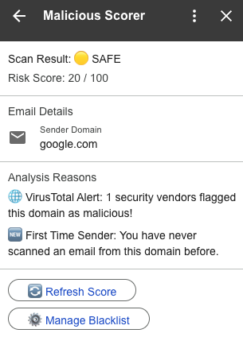
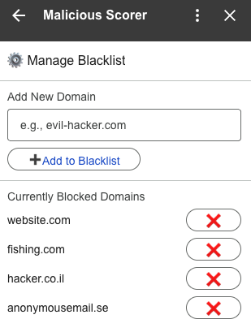
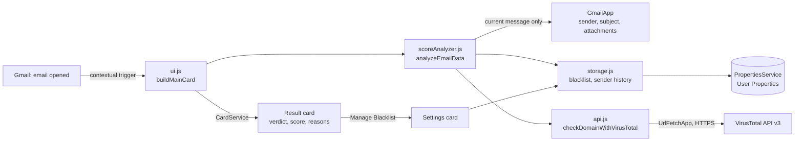

# Malicious Scorer: Gmail Security Add-on 🛡️

A Google Workspace add-on that lives in Gmail's side panel and acts as a real-time **phishing analyzer**. Every time you open an email, it calculates a **risk score from 0 to 100**, explains exactly why, and checks the sender's domain against **VirusTotal**'s global threat intelligence. It's built entirely on Google Apps Script, with no servers to run.

<p align="center">
  
  &nbsp;&nbsp;
  
</p>

| Verdict | Score |
|---|---|
| 🟢 CLEAN | 0 |
| 🟡 SAFE | 1 – 29 |
| 🟠 SUSPICIOUS | 30 – 69 |
| 🔴 MALICIOUS | 70 – 100 |

## Contents

- [How the score is calculated](#how-the-score-is-calculated)
- [Features](#features)
- [Architecture](#architecture)
- [Permissions](#permissions)
- [Set up your own copy](#set-up-your-own-copy)
- [Limitations and next steps](#limitations-and-next-steps)

## How the score is calculated

Five rules run on the open email; each adds points and a human-readable reason:

| # | Rule | Points |
|---|---|---|
| 1 | The sender's domain is on your **personal blacklist** | +100 |
| 2 | The subject contains a suspicious keyword: `urgent`, `password`, `invoice`, `action required`, `login` | +25 each |
| 3 | A **dangerous attachment**: `.exe`, `.bat`, `.js`, `.vbs`, `.scr`, `.jar` | +40 each |
| 4 | **VirusTotal**: security vendors that flag the sender's domain as malicious | +15 per vendor |
| 5 | **Sender history**: the first email you've opened from this domain | +5 |
| | … more than 10 different emails opened from this domain | −5 |

The total is limited to 0–100. Sender history counts each email once, so reopening an email or pressing **Refresh Score** doesn't change it.

**Example** (left screenshot above). An email from `google.com` scores **20 → 🟡 SAFE**: one VirusTotal vendor flags the domain (+15), and it's the first email scanned from that domain (+5). A single vendor's flag on a well-known domain is usually a false positive, so on its own it isn't enough to make an email suspicious; the thresholds are set so that several signals have to add up.

## Features

- **Real-time risk scoring** shown in the Gmail side panel as soon as an email is opened, on the web and in the Gmail mobile apps.
- **Explainability:** an *Analysis Reasons* section lists every factor behind the score, not just the number.
- **Threat intelligence:** a live VirusTotal lookup of the sender's domain on every scan.
- **Personal blacklist:** add or remove domains from a settings card (right screenshot above); the list updates on screen immediately and is stored per user.
- **Refresh Score** recalculates the current email, for example after you change the blacklist.

## Architecture



- **Server-driven UI.** The cards are built with Google's **CardService** on the server, so the same code renders natively in Gmail on the web, Android and iOS.
- **Contextual trigger.** `appsscript.json` registers `buildMainCard` to run whenever an email is opened. Gmail passes a per-message access token, so the add-on can read **only the email that's open**.
- **Storage.** The blacklist and sender history live in **User Properties**, Google's per-user key-value store, so each user's data is private to them.
- **Secrets.** The VirusTotal API key is read from **Script Properties**, never from the code.

| File | Responsibility |
|---|---|
| `appsscript.json` | Manifest: add-on name and logo, Gmail trigger, OAuth scopes, V8 runtime |
| `ui.js` | The result card, the blacklist settings card, and the button handlers |
| `scoreAnalyzer.js` | Reads the open email, extracts the sender's domain, applies the five rules, decides the verdict |
| `api.js` | VirusTotal lookup of a domain (number of vendors that flag it) |
| `storage.js` | Blacklist add/remove and sender history, in User Properties |
| `docs/screenshots/` | Images used in this README (not uploaded to Apps Script) |
| `README.js` | Project notes kept inside the Apps Script editor (which can't hold Markdown files) |

## Permissions

The add-on asks for the narrowest Gmail access available:

| Scope | Why |
|---|---|
| `gmail.addons.execute` | Run as a Gmail add-on |
| `gmail.addons.current.message.readonly` | Read **only the currently open email**, read-only |
| `script.external_request` | Call the VirusTotal API |
| `script.locale` | Use the user's language settings |

It can't read your other emails, send mail, or change anything in your mailbox.

## Set up your own copy

Requirements: [Node.js](https://nodejs.org), Google's [clasp](https://github.com/google/clasp) CLI, and a free [VirusTotal API key](https://www.virustotal.com/gui/join-us).

1. Turn on the Apps Script API at https://script.google.com/home/usersettings.
2. Create your own Apps Script project from this code. `.clasp.json` points to the author's project, so replace it with your own:
   ```bash
   npm install -g @google/clasp
   clasp login
   rm .clasp.json
   clasp create --type standalone --title "Malicious Scorer"
   clasp push
   ```
3. In the Apps Script editor, open **Project Settings → Script Properties** and add `VT_API_KEY` with your VirusTotal key.
4. Choose **Deploy → Test deployments → Install** for Gmail, then open any email in Gmail and look for the 🛡️ icon in the side panel.

To update the add-on after editing the code: `clasp push`.

## Limitations and next steps

- **Attachments** are judged by file extension, not by their content. A next step is sending files for sandbox analysis.
- **Links** in the email body aren't scanned yet. A next step is extracting URLs and checking them with VirusTotal.
- **Rate limits.** VirusTotal's free API allows 4 lookups a minute and 500 a day. Caching domain results would make the add-on suitable for high email volumes.
- **Blacklist matching** is exact: blocking `example.com` doesn't block `mail.example.com`.

## Author

Jonathan Hadar ([@JonHadar](https://github.com/JonHadar)) · [Portfolio](https://jonathan-hadar.vercel.app)
